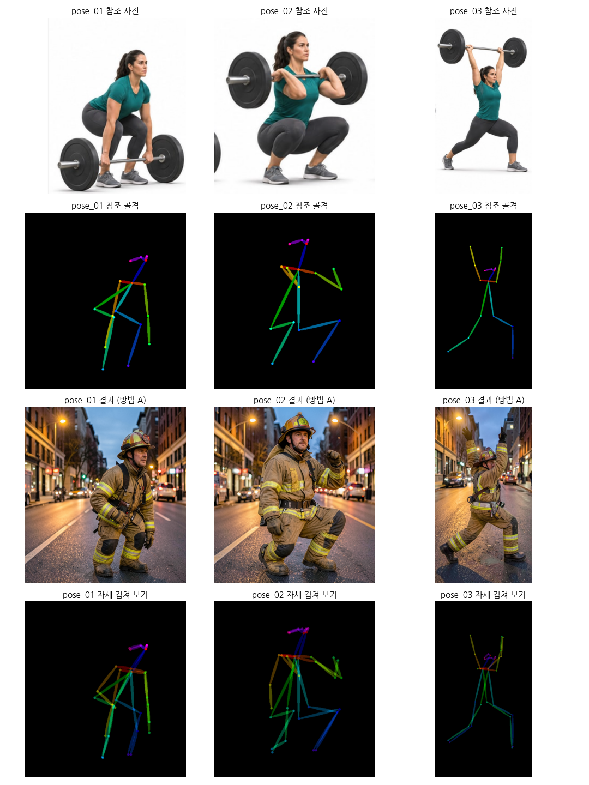
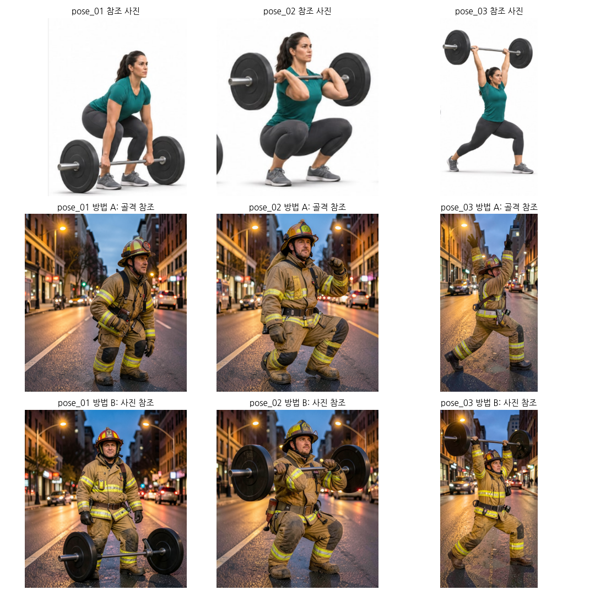
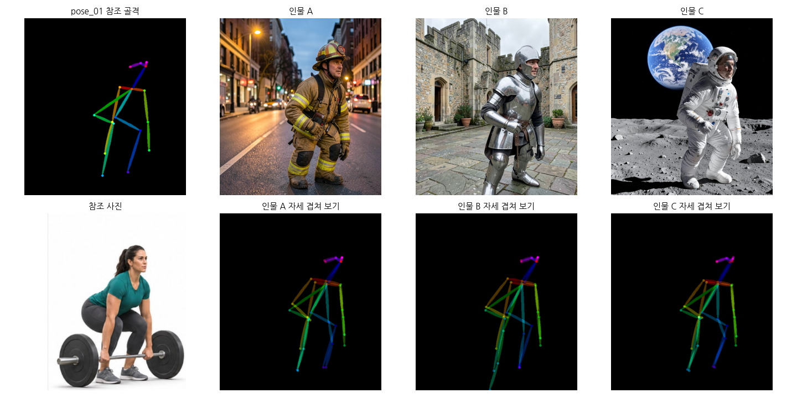
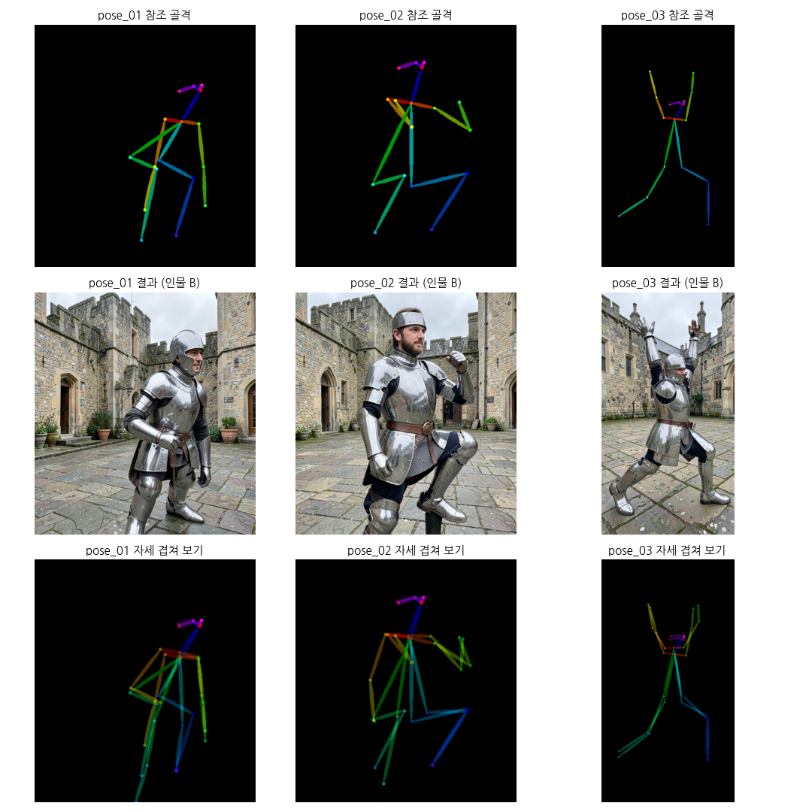
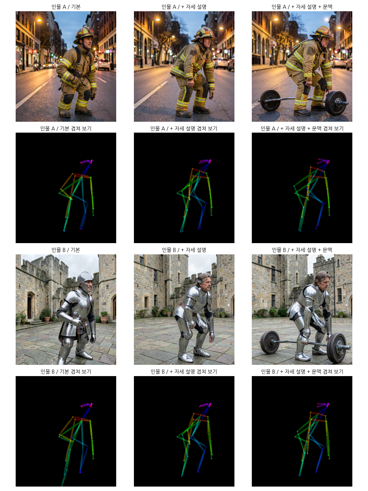

# 원하는 포즈로 이미지 만드는 도구

참조 사진 속 사람의 자세를 OpenPose로 뽑아, 그 자세를 한 다른 인물·장면을 FLUX.2-klein 4B로 만드는 Colab 튜토리얼입니다.

## 도구 설명
- 참조 사진 → **OpenPose**로 관절 18개를 찾아 골격 이미지를 만듭니다.
- 골격 이미지를 **FLUX.2-klein 4B의 참조 이미지**로 넣고, 프롬프트로 인물과 장면을 지정합니다.
- FLUX.2용 공식 ControlNet이 없어서(2026-07 기준), ControlNet 대신 FLUX.2-klein에 내장된 **참조 이미지 편집 기능**(ComfyUI `ReferenceLatent` 노드)으로 자세를 전달합니다.
- 무료 Colab T4에서 돌리기 위해 GGUF Q4 양자화 모델을 ComfyUI로 실행합니다. (원본 BF16 모델은 Colab 시스템 RAM 부족으로 실행 불가)

```
참조 사진 ─▶ OpenPose ─▶ 골격 이미지 ─┐
                                      ├─▶ FLUX.2-klein 4B ─▶ 같은 자세의 새 이미지
프롬프트 ──────────────────────────────┘
```

## 사용법
1. `pose_tool.ipynb`를 Colab에서 열고, 런타임 유형을 **T4 GPU**로 바꿉니다.
2. 1~5번 셀을 실행합니다. (설치·모델 다운로드·ComfyUI 서버 실행, 처음 한 번 약 10분)
3. 6번 셀에서 자세가 서로 다른 전신 사진 2~3장을 올립니다.
4. 7~13-1번 셀을 차례로 실행합니다. (포즈 추출 → 생성 → 조건 실험)
5. 14번 셀이 `samples/`와 `prompts.md`를 zip으로 내려받습니다.

설정: seed 1234, 4 steps, CFG 1.0, euler / simple. 프롬프트 전문은 [`prompts.md`](prompts.md)에 있습니다.

## 테스트 결과

### 기본: 골격 참조로 같은 자세 만들기 (인물: 소방관)


| 포즈 | 참조 자세 | 결과 |
| --- | --- | --- |
| pose_01 | 바벨을 들기 직전, 엉덩이를 뒤로 빼고 무릎을 굽힘 | 무릎을 굽히고 상체를 숙인 자세가 맞음. 한쪽 팔 위치만 조금 다름 |
| pose_02 | 프런트 스쿼트, 팔꿈치를 앞으로 들고 깊게 앉음 | 낮게 앉은 자세는 맞지만 팔이 다름. **OpenPose가 한 팔을 무릎 쪽으로 잘못 검출**했고, 결과는 그 잘못된 골격을 따름 |
| pose_03 | 양팔을 머리 위로 올린 런지 | 양팔·다리 모두 맞음. 팔 벌어진 각도만 조금 넓음 |

`자세 겹쳐 보기`는 결과 이미지에서 다시 OpenPose를 뽑아 참조 골격과 50%씩 겹친 것입니다. 선이 한 줄로 겹치면 자세가 같고, 두 줄로 벌어진 곳이 어긋난 관절입니다.

### 비교: 골격 참조(방법 A) vs 원본 사진 참조(방법 B)


- 방법 B는 **바벨까지 결과에 따라왔습니다.** 자세만이 아니라 사진 속 소품도 옮겨집니다.
- 방법 B의 pose_01은 똑바로 선 자세로 바뀌어 **자세 유지에 실패**했고, pose_02·03은 자세를 잘 유지했습니다.
- 자세만 옮기려면 방법 A, 소품을 든 동작까지 옮기려면 방법 B가 맞습니다.

### 조건 실험 1: 같은 포즈(pose_01), 다른 프롬프트


- 소방관·기사·우주비행사 모두 **같은 자세**가 나왔고, 겹쳐 보기에서도 거의 일치합니다. 갑옷·우주복처럼 몸을 가리는 옷에서도 자세가 유지됐습니다.
- 참조 사진은 여성인데 결과는 **세 장 모두 남성**입니다. 골격에는 성별 정보가 없고 프롬프트에도 적지 않아서, 모델이 그 직업에 흔한 모습으로 채운 것으로 보입니다. 원하는 인물이 있으면 프롬프트에 적어야 합니다.

### 조건 실험 2: 다른 포즈, 같은 프롬프트(기사)


- pose_01·03은 자세를 잘 따랐습니다.
- pose_02(깊은 스쿼트)는 **한쪽 무릎을 들어 올린 자세로 바뀌었습니다.** 같은 골격으로 소방관은 낮게 앉은 자세가 나왔으니, 인물 설명에 따라 자세 해석이 달라진 것입니다. 갑옷을 입고 쪼그려 앉은 사진이 학습 데이터에 드물기 때문으로 추정합니다.

### 조건 실험 3: 같은 골격(pose_01)에 자세를 말로 보충


- pose_01(데드리프트 준비 자세)에서 결과 인물이 **키가 작고 다리가 짧게** 나왔다. 엉덩이를 뒤로 빼면 허벅지가 카메라 쪽을 향해 짧게 찍히고(단축), OpenPose 골격에는 깊이 정보가 없어서 골격이 "상체를 세운 키 작은 사람" 모양이 된 것으로 보인다.
- 프롬프트에 "엉덩이를 접고 숙인 자세, 정상 체형"을 보충했더니 상체는 숙여졌지만 **손을 무릎에 짚은 어색한 자세**가 됐고 다리는 여전히 짧았다. 겹쳐 보기에서 골격 일치도는 오히려 떨어졌다.
- 골격(세운 상체)과 프롬프트(숙인 상체)가 충돌해 모델이 중간 자세로 절충한 것으로 보인다. 프롬프트가 길어지면서 **기사의 투구가 사라지는** 부작용도 생겼다.
- 바닥의 바벨을 잡는 문맥까지 넣으면 자세가 가장 자연스러웠지만, 원하지 않은 소품(바벨)이 생겼다.

## 한계
- **OpenPose 검출이 정확도의 상한입니다.** 골격이 잘못 뽑히면 결과도 잘못된 골격을 그대로 따릅니다(pose_02의 팔).
- **깊게 앉은 자세처럼 다리가 겹치는 자세**에 약합니다.
- **팔다리가 카메라 방향을 향하는 자세**(엉덩이를 뒤로 빼는 자세 등)는 2D 골격에서 짧게 잡혀 결과 인물의 체형이 압축됩니다. 프롬프트로 자세를 보충하면 골격과 충돌해 오히려 어색해졌습니다. 측면에서 찍은 참조 사진을 쓰는 편이 낫습니다.
- 손 관절은 쓰지 않아서 **손 모양은 제어되지 않습니다.**
- 결과 비율이 참조 사진 비율을 따르고, 인물 설명에 따라 **발이 화면 밖으로 잘리는** 경우가 있습니다(기사).
- ControlNet이 아니라 참조 이미지 방식이라, 자세를 따르는 정도를 숫자로 조절할 수 없습니다.

## 사용한 모델·도구
- [FLUX.2-klein 4B](https://huggingface.co/black-forest-labs/FLUX.2-klein-4B) (Apache 2.0), GGUF 변환: [unsloth/FLUX.2-klein-4B-GGUF](https://huggingface.co/unsloth/FLUX.2-klein-4B-GGUF)
- [ComfyUI](https://github.com/comfyanonymous/ComfyUI), [ComfyUI-GGUF](https://github.com/city96/ComfyUI-GGUF)
- OpenPose 검출: [controlnet_aux](https://github.com/huggingface/controlnet_aux) (`lllyasviel/Annotators`)

## 참조 사진 출처
- pose_01 ~ pose_03: **(출처를 적으세요)**
